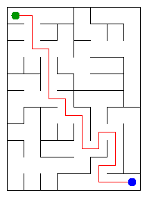

# Assignment 3. Maze Escape

<!-- identity:start -->
Student ID: 250655  
Name: Rustam Kabdolda  
Group: Not supplied  
Maze size: 11 x 8
<!-- identity:end -->

<!-- variant-status:start -->
Personal data generated with the exact ID `250655`.
<!-- variant-status:end -->

## Build and run

Use a **JDK 17 or newer**, including both java and javac. Run commands from this folder.

```sh
javac --release 17 -d out src/*.java
java -cp out Main
java tools/Check.java
```

Main reads data/walls.txt and data/slides.txt without keyboard input, prints 13 integer results, and writes output/maze.png and output/maze.html. Open the HTML in a browser to inspect the maze and walk using arrow keys. If a terminal does not expand src/*.java, the Check tool also compiles all sources.

To generate personal data and update this report, preserving leading zeroes in the ID:

```sh
java tools/Personalize.java 250655 "Rustam Kabdolda" "YOUR_GROUP"
```

This helper runs the original MakeVariant, compiles for Java 17, runs Main and updates the identity, dimensions, output, MST cost and picture. It does not upload anything. Main, Input, Graphs, Render, Generator and Bench are unchanged from the starter.

## Program output

<!-- program-output:start -->
```text
Broken: 87
Kept: 70
Last broken wall: 126
MST cost: 29250
Heaviest broken wall: 780
Path length: 21
DFS visited: 59
Dead ends: 30
Zones: 9
Largest zone: 15
Is DAG: 0
Flow stages: 4
Fastest route cost: 14
```
<!-- program-output:end -->



The picture shows the tree built in **file order** (Mission 1). The cheapest tree of Mission 2 is computed separately.

## Questions

### Mission 0. DSU operations

find(x) returns the root representing the group containing x. union(a,b) joins different groups and returns true, or returns false if they already share a root; only a successful union decreases count(). Union by size keeps trees shallow, while path compression makes subsequent searches point directly to the root; find uses iterative walks.

### Mission 1. Broken and kept walls

There are n = R*C cells and m = R*(C-1) + C*(R-1) inner walls. Each accepted wall joins different components without creating a cycle; because the full grid is connected, the component count falls from n to one, so exactly n-1 walls are broken. The remaining count is m-(n-1) = RC-R-C+1 = (R-1)*(C-1).

### Mission 2. Kruskal and Prim

<!-- mst-cost:start -->
Kruskal = Prim = **29250**.
<!-- mst-cost:end -->

Kruskal accepts edges joining different DSU components in increasing cost order. Prim grows a tree from cell 0 using the cheapest edge to an unvisited cell and ignores stale heap entries. Both choices are safe by the cut property, so both produce an MST with the same total cost; distinct costs also make the MST unique.

### Mission 3. Unique path and stack safety

The constructed graph is connected and has no cycles, so it is a tree. Connectivity guarantees a path; two different simple paths between the same cells would form a cycle, so the path is unique. DFS stores active cells and next directions in heap arrays, tries up/right/down/left, marks on entry and stops immediately on entering the exit, avoiding recursive stack overflow.

### Mission 4. Kosaraju and cycles

The first DFS runs on the original graph and records vertices when their searches finish. In decreasing finish order, the next unassigned SCC is a source among the remaining original components; reversing edges prevents the search from escaping to another unassigned component, so the second pass collects exactly one SCC at a time. Discovery numbers therefore give a topological order of the original zone graph. With self-slides excluded by the assignment, a cycle exists exactly when some SCC has more than one cell, so Zones equals n exactly for a DAG.

### Mission 5. Zone order and route pass

Every inter-zone edge goes from a smaller zone number to a larger one, so all incoming contributions are ready when a zone is processed. Internal slides are ignored and parallel inter-zone slides are merged by minimum time; one pass updates shortest distances from the start zone and longest chain lengths starting anywhere, initially one zone per chain. With k zones and q distinct zone edges, the pass costs O(k+q) time and O(k) extra DP space; constructing the quotient graph costs expected O(n+m) time using hash maps and O(k+q) space. Walking inside a zone is free by the task definition.

## AI use

OpenAI Codex inspected the assignment and starter, generated the DSU, maze, DFS and zone implementations, added tests and a personalization helper, ran validation and benchmarks, and drafted this report. The input reader, graph helpers, generator, renderer, entry point, benchmark and supplied examples come from the course starter. No graph or DSU library or external code source was used. Local implementation commits are attributed to Codex.

This is an AI-assisted draft. Before submission the student must review and adapt the work, understand every line and revise the answers into their own words according to the assignment rules. Keep the disclosure accurate; do not replace it with "none".

## Validation

- java tools/Check.java: all DSU checks pass, and tiny, small and dag match all 13 expected lines each.
- java -cp out tools/ExtraChecks.java: 120 small maze cases compare MST costs with exhaustive tree enumeration and DFS with a recursive oracle limited to six cells. Another 500 random slide graphs compare SCCs with transitive closure and routes with Floyd-Warshall and exhaustive DAG paths. Explicit cases test parallel inter-zone slides and costs beyond 32-bit integers.
- java -Xmx2g -Xss256k -cp out tools/ExtraChecks.java stress: a 1000 x 1000 snake maze and a 1,000,000-cell slide chain return the expected DFS path, SCC order, longest chain and route cost with a small JVM stack.
- Sources compile using --release 17. Execution was tested on OpenJDK 25.0.1, Windows x64; a Java 17 runtime was not separately tested.

Check renders its examples and overwrites the image with its last example. Run Main again afterwards, or run Personalize, to restore the picture for data/.

## Timing (Mission 7)

Measured with the unchanged Bench class: five runs per size, arithmetic mean in milliseconds. Command: java -Xmx2g -cp out Bench. Machine: AMD Ryzen 7 7435HS, 32 GiB RAM, Windows x64, OpenJDK 25.0.1. No other benchmark or stress test ran concurrently.

| Maze | Kruskal, five runs (ms) | Mean (ms) | Prim, five runs (ms) | Mean (ms) |
|---|---|---:|---|---:|
| 100 x 100 | 17, 11, 10, 27, 26 | 18 | 25, 5, 12, 5, 6 | 11 |
| 300 x 300 | 148, 99, 78, 67, 61 | 91 | 95, 85, 97, 102, 89 | 94 |
| 1000 x 1000 | 1428, 1761, 1779, 1809, 1718 | 1699 | 2435, 2722, 2515, 2526, 2530 | 2546 |

The means are rounded by the original Bench class from unrounded timings. See output/benchmark.txt for its raw console output. Increasing the side length by ten increases the number of cells by one hundred, so input growth must be compared with cell count rather than side length. For a grid both algorithms have O(n log n) time, consistent with the increasing work in sorting or heap operations; JIT warm-up, allocation, garbage collection and measurement noise also affect these short runs. Prim is slower on the largest case here, but these five runs on one machine do not establish a universal ranking.

## Complexity

n is the number of cells; m is the number of walls for maze algorithms or slides for slide algorithms. k is the number of SCCs, q the number of distinct inter-zone edges. Space includes auxiliary graph representations and returned arrays, excluding the input arrays.

| Algorithm | Time | Space | Assumptions |
|---|---|---|---|
| DSU find / union | Amortized O(alpha(n)) per operation; initialization O(n) | O(n) for DSU; O(1) per operation | Union by size and path compression; alpha is inverse Ackermann |
| Build in file order | O(n + m*alpha(n)) | O(n) | Connected rectangular grid |
| Kruskal | O(n + m log m) | O(n+m) | Sort edge indices, then DSU; sorting dominates union operations |
| Prim | O(n + m log(m+1)) | O(n+m) | Lazy edge heap; each wall enters at most once; on a grid m=O(n), giving O(n log n) |
| DFS escape | O(n+m) | O(n+m) | Open graph is a tree with m=n-1 and degree at most 4, giving O(n) time and space |
| Kosaraju | O(n+m) | O(n+m) | Forward/reverse lists and iterative DFS stacks |
| Route in zone graph | Expected O(n+m) including construction; DP pass O(k+q) | O(k+q) | Hash map merging; DP arrays use O(k); no priority queue |

## Git and submission

The local repository uses main with an initial starter commit and individual commits for Missions 0-5, followed by report and timing commits. No GitHub remote is configured; nothing has been submitted to Moodle.

1. The personal data for Student ID 250655 and name Rustam Kabdolda are generated. Fill in the group, which was not supplied.
2. Review the implementation and rewrite answers as needed; retain an accurate AI-use note.
3. Run Check, then Main; compare the final output with the report.
4. Commit personalization and review changes with a descriptive message.
5. Create a public GitHub repository, add its URL as origin and push main. Check the link without signing in.
6. Submit the repository link in Moodle before the deadline.

The archive preserves the hidden .git directory and history. Extract hidden files too, and verify using git log --oneline.
